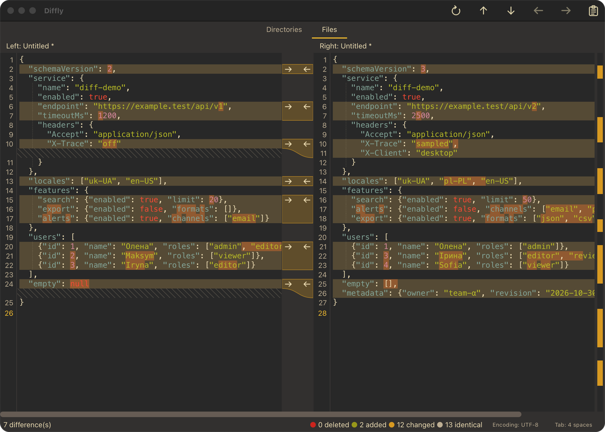

# Diffly



Screenshot using the [JSON example files](tests/fixtures/diff/README.md).

Diffly is a two-pane text comparison and merge editor for macOS and Linux. This repository implements the Phase 1 MVP in [SPEC.md](SPEC.md).

## Run

Requires Python 3.11 or newer.

To install Diffly as a command available outside this repository, use `uv` from the repository root:

```sh
uv tool install --python 3.12 .
diffly
```

`uv` keeps Diffly and its dependencies in a dedicated environment instead of installing them into the system Python. If `diffly` is not found, run `uv tool update-shell` and open a new terminal. After changing the source code, run `uv tool install --reinstall --python 3.12 .` to update the installed copy.

For development, create a virtual environment in the repository instead:

```sh
python3 -m venv .venv
.venv/bin/python -m pip install -e .
.venv/bin/diffly
```

To build a macOS app that can launch from Applications:

```sh
scripts/build-macos-app.sh
open dist
```

Drag `Diffly.app` from the opened `dist` folder into Applications in Finder. The build includes Python, Qt, and the bundled theme configuration, so the `.app` does not depend on this repository or its virtual environment. Run the build again after code changes and replace the copy in Applications. The app is built for the current Mac's CPU architecture and is signed locally; distributing it to other Macs requires Developer ID signing and notarization.

Open one or two files directly from the command line:

```sh
.venv/bin/diffly left.txt right.txt
.venv/bin/diffly left.txt
```

Relative paths are resolved from the current working directory. The first file opens in the left pane and the optional second file opens in the right pane. Run `diffly --help` for usage.

Open a file into each pane with **File → Open Left/Right**. Edit either pane independently. Colored rows show differences, and stronger color marks changed text within replaced lines. Click a changed row or navigate with the toolbar to select a diff block, then apply it with the toolbar or delete it from the Edit menu. Each action is one Undo operation in its destination editor. Save each pane independently. A failed save leaves the original file untouched.

The toolbar at the top navigates between differences, applies the selected block in either direction, and pastes clipboard text into the active editor at its cursor. Hovering a toolbar button shows a border without changing the icon color. The paired-pane icons show the destination of each apply action. Both editors show line numbers; recognized source and markup files also show faint dotted indent guides every four spaces by default to trace nesting levels. Missing lines are shown as diagonally hatched spaces, aligning the following text without changing either file. A slightly wider colored diff overview at the far right replaces the visible vertical scrollbar. Click or drag its viewport marker to scroll both panes; the mouse wheel over either editor also scrolls them together. One horizontal scrollbar below both panes controls their horizontal offsets; horizontal trackpad gestures and Shift+wheel scroll both panes too. A shorter pane stops at its own right edge.

On macOS, Diffly sets the native toolbar to the compact inline titlebar style. The editors use the full width of the window. The status bar shows deleted, added, changed, and identical line counts. Next to **Tab: 2/4 spaces**, the **Encoding** button shows the active pane's encoding. Its menu lists **Auto** and the available encodings. Choosing one reopens an existing file with that encoding; for an untitled pane it sets the encoding used when saving. Click **Tab: 2/4 spaces** to switch tab stops and indent guides; the choice is saved in the user TOML config. A double-click on an empty part of the Qt toolbar toggles a maximized window without entering fullscreen. A double-click on the empty title area also toggles a maximized window without entering fullscreen.

When run from a terminal, **Ctrl+C** closes Diffly through the usual unsaved-changes check.

On macOS, press **Command+Option+Down** for the next difference and **Command+Option+Up** for the previous one. **Command+Option+Left/Right** applies the selected difference toward the arrow. On Linux, use **Ctrl+Alt** with the same arrow keys. Navigation moves the text cursor to the changed line in the active editor. **Command+Option+Delete** on macOS or **Ctrl+Alt+Delete** on Linux deletes the selected block from the active editor. Plain arrow and Delete keys retain their usual text-editing behavior inside an editor.

The bundled [TOML configuration](src/diffly/config.toml) defines font size, tab width, the initial theme, and four themes: Gruvbox Dark, Dark, Light, and Solarized Dark. Choose a theme from the **Theme** menu; Diffly saves that choice to the user TOML configuration. For other persistent overrides, create `~/.config/diffly/config.toml` with only the values you want to change, for example:

```toml
[settings]
theme = "light"
font_family = "Menlo"
font_size = 14
tab_width = 4
indent_guide_width = 4
```

Set `DIFFLY_CONFIG` to use another TOML path. An empty `font_family` selects the system monospace font. Theme definitions in the override can replace individual colors under `[themes.<theme_id>]`.

UTF-8 and Unicode BOMs are detected directly; other text encodings are detected with charset-normalizer. Short or ambiguous files may need an explicit choice from the **Encoding** menu. Diffly preserves the detected encoding, BOM, and line endings when saving an opened file. JSON, Python, JavaScript, PHP, Go, Rust, Bash, YAML, TOML, and Markdown files have syntax coloring through [Pygments](https://pygments.org/docs/lexers/); untitled buffers are detected from their first lines. Lexing runs in a separate process after a short debounce, and results are accepted only for the current document revision. Existing syntax and diff colors remain visible while new results are computed. Only changed syntax blocks are reformatted; cached colors follow line insertions and local edits. Syntax coloring is disabled above 2 MB while large-file editing remains a future phase. The current editor loads whole files; virtualized large-file editing, directory comparison, and packaging are later phases.

## Development

To use the committed `uv.lock` for reproducible development dependencies:

```sh
uv run --locked --extra dev pytest
```

Alternatively, install the development dependencies with pip:

```sh
.venv/bin/python -m pip install -e '.[dev]'
.venv/bin/python -m pytest
```
