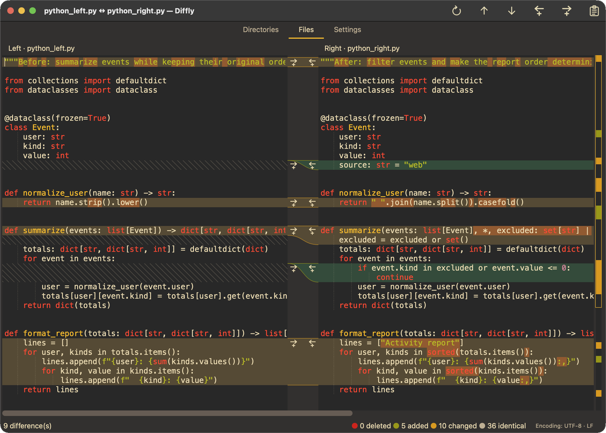
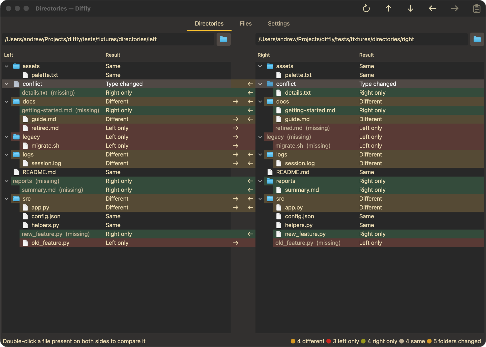

<div align="center">


# Diffly

**A responsive desktop app for comparing, editing and merging text files and directories.**


[](LICENSE)

[Features](#features) •
[Install](#install) •
[macOS app](#build-the-macos-app) •
[Usage](#usage) •
[User guide](docs/guide.md)

<a href="docs/images/diffly-python.png"></a>

</div>

## Features

- **Side-by-side editing.** Both panes are editable, with aligned lines, changed text highlighted inside each line, and a colored overview of the whole file.
- **Move changes in one click.** Apply a block in either direction, replacing the other side or appending to it, with full Undo.
- **Three-way merge.** Separate changes merge automatically, and conflicts are resolved one by one. Works as a Git mergetool.
- **Directory comparison.** Side-by-side trees compared by content, with file and folder copying. Respects `.gitignore` and custom masks.
- **Syntax highlighting.** Python, JavaScript, TypeScript, Go, Rust, JSON, SQL, Markdown and more.
- **Careful with your files.** Keeps the detected encoding, BOM and line endings. A failed save leaves the original untouched.
- **Comparison rules.** Optionally ignore trailing whitespace, all whitespace or letter case.
- **Yours to configure.** Four built-in themes, TOML configuration, and saved and recent comparisons.

<a href="docs/images/diffly-directories.png"></a>

## Install

Diffly has no prebuilt releases yet, so you install it from source. You need Python 3.11 or newer, and [uv](https://docs.astral.sh/uv/) for the commands below.

```sh
git clone https://github.com/gandriyko/diffly.git
cd diffly
uv tool install --python 3.12 .
diffly
```

`uv` keeps Diffly and its dependencies in a dedicated environment instead of installing them into the system Python. If `diffly` is not found, run `uv tool update-shell` and open a new terminal. After changing the source code, run `uv tool install --reinstall --python 3.12 .` to update the installed copy.

### Build the macOS app

You can build a standalone `Diffly.app` that launches from Applications like any other Mac app:

```sh
scripts/build-macos-app.sh                    # build dist/Diffly.app only
scripts/build-macos-app.sh --install          # also replace /Applications/Diffly.app
scripts/build-macos-app.sh --install --open   # install and launch it
```

Without `--install`, drag `Diffly.app` from the `dist` folder into Applications in Finder. The build includes Python, Qt, and the bundled theme configuration, so the `.app` does not depend on this repository or its virtual environment. Run the build again after code changes and replace the copy in Applications.

The app is built for the current Mac's CPU architecture and is signed locally; distributing it to other Macs requires Developer ID signing and notarization.

## Usage

```sh
diffly                                  # open the app
diffly left.txt right.txt               # compare two files
diffly --directories left_dir right_dir # compare two directories
diffly --merge base.txt left.txt right.txt --output result.txt  # three-way merge
```

### Use as a Git mergetool

```sh
git config --global merge.tool diffly
git config --global mergetool.diffly.cmd 'diffly --merge "$BASE" "$LOCAL" "$REMOTE" --output "$MERGED"'
git config --global mergetool.diffly.trustExitCode true
```

After a conflicting `git merge`, run `git mergetool --tool=diffly`. Git needs the `diffly` command on your `PATH`, because a detached `open -a` launch of the app cannot report the result back to Git.

### Keyboard shortcuts

| Action | macOS | Linux |
|---|---|---|
| Next / previous difference | <kbd>⌘</kbd> <kbd>⌥</kbd> <kbd>↓</kbd> / <kbd>↑</kbd> | <kbd>Ctrl</kbd> <kbd>Alt</kbd> <kbd>↓</kbd> / <kbd>↑</kbd> |
| Apply selected difference | <kbd>⌘</kbd> <kbd>⌥</kbd> <kbd>←</kbd> / <kbd>→</kbd> | <kbd>Ctrl</kbd> <kbd>Alt</kbd> <kbd>←</kbd> / <kbd>→</kbd> |
| Append instead of replacing | add <kbd>⇧</kbd> | add <kbd>Shift</kbd> |
| Find / replace | <kbd>⌘</kbd> <kbd>F</kbd> / <kbd>H</kbd> | <kbd>Ctrl</kbd> <kbd>F</kbd> / <kbd>H</kbd> |
| Save active editor | <kbd>⌘</kbd> <kbd>S</kbd> | <kbd>Ctrl</kbd> <kbd>S</kbd> |

The [user guide](docs/guide.md) covers every tab, shortcut and configuration option. Sample [files](tests/fixtures/diff/README.md) and [directories](tests/fixtures/directories/README.md) are included for trying Diffly out, and the design is described in [SPEC.md](SPEC.md).

## Development

To use the committed `uv.lock` for reproducible development dependencies:

```sh
uv run --locked --extra dev pytest
```

Alternatively, use a virtual environment and pip:

```sh
python3 -m venv .venv
.venv/bin/python -m pip install -e '.[dev]'
.venv/bin/diffly
.venv/bin/python -m pytest
```

Set `DIFFLY_NO_DIALOGS=1` for scripted or automated runs: modal dialogs are not shown, questions answer Yes, notices are printed to stderr and file pickers cancel. The test suite enables it in `tests/conftest.py`.

## License

Diffly is released under the [MIT License](LICENSE).
